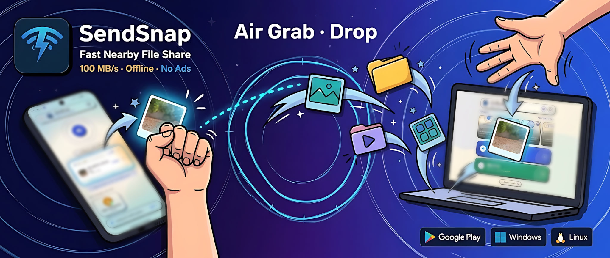

<div align="center">

  

  <h1>SendSnap</h1>
  <p><strong>Lightning-Fast, Offline Peer-to-Peer File Sharing for Android &amp; Windows</strong></p>

  <p>
    <a href="https://github.com/Youssef0356/SendSnap/releases/tag/v2.2.9"></a>
    
    <a href="https://flutter.dev"></a>
    <a href="https://dart.dev"></a>
    <a href="sendsnap/PRIVACY_POLICY.md"></a>
    <a href="LICENSE"></a>
  </p>

  <p>
    Transfer gigabytes of photos, 4K videos, apps, archives, documents, and folders at up to <strong>100 MB/s</strong> over local Wi-Fi or Direct Hotspot — with <strong>zero internet, zero cloud uploads, zero accounts, and zero ads</strong>.
  </p>

  <p>
    <a href="https://youssef0356.github.io/sendsnap_website/downloads/sendsnap-windows-x64.zip"></a>
    &nbsp;
    
    &nbsp;
    <a href="https://youssef0356.github.io/sendsnap_website/"></a>
  </p>

  <br />

  

</div>

> [!NOTE]
> **Active Development:** SendSnap is still under active development. Features, UI, and protocols are actively evolving, and the **Google Play** release for Android is **coming soon**. In the meantime, you can try the Windows build or build the Android APK directly from source.

---

## Preview

<table>
  <tr>
    <td align="center" width="25%">
      
      <br /><sub><b>One-Tap Send &amp; Receive</b></sub>
    </td>
    <td align="center" width="25%">
      
      <br /><sub><b>Instant Nearby Radar</b></sub>
    </td>
    <td align="center" width="25%">
      
      <br /><sub><b>Built-In File &amp; Media Browser</b></sub>
    </td>
    <td align="center" width="25%">
      
      <br /><sub><b>Manage Received Files</b></sub>
    </td>
  </tr>
</table>

---

## Key Features

- **Gigabit Local Speeds**: Stream large batches of photos, 4K videos, APKs, archives, and documents at up to **100 MB/s** over local Wi-Fi, Wi-Fi Direct, or Personal Hotspot.
- **Zero-Delay Multi-Layer Discovery**: Automatically finds nearby devices using UDP multicast/broadcast, subnet HTTP probing, Wi-Fi Direct / Local Hotspot pairing, and **BLE discovery beacons**, with instant **QR code** and **manual IP** fallback for restricted networks.
- **True Cross-Platform Sharing**: Seamlessly transfer between **Android** and **Windows PC** (with Linux desktop packaging scripts included).
- **Handcrafted Sketch-Ink UI & Dark Mode**: Warm paper & Sumi-ink Light Mode and high-contrast Chalk-ink Dark Mode designed for clarity across phones and desktops.
- **Interactive Drag-and-Drop & Multi-File Queue**: Drag files from your desktop or in-app tray onto nearby devices—either one by one or as a full batch—and inspect everything on the Windows two-pane completion screen with the built-in **Media Viewer**.
- **Built-In File & Media Browser**: Browse Images, Videos, Audio, Documents, Apps, Archives, Recents, or Any File with instant search, plus native **Android Share Sheet** and **Windows Explorer / System Tray** integration.
- **Experimental Bare-Hand Air Gestures**: Camera-assisted hand-grab gestures for touchless sharing sessions on supported Android and Windows devices.
- **Multilingual & RTL Ready**: Full localization in **English**, **French**, **Arabic** (with automatic RTL layout mirroring & BiDi-safe filenames), and **Spanish**, switchable right from the home bar.
- **100% Offline, Ad-Free & Private**: No trackers, no analytics SDKs, no cloud servers, and no account required. See [PRIVACY_POLICY.md](sendsnap/PRIVACY_POLICY.md).

---

## Downloads

| Platform | Package | Status / Download |
| :--- | :--- | :--- |
| **Android** | Google Play Store | *Coming Soon* (or [build APK from source](#building-from-source)) |
| **Windows (64-bit)** | Portable `.zip` Archive | [Download `sendsnap-windows-x64.zip`](https://youssef0356.github.io/sendsnap_website/downloads/sendsnap-windows-x64.zip) |
| **Windows (64-bit)** | Portable `.rar` Archive | [Download `sendsnap-windows-x64.rar`](https://youssef0356.github.io/sendsnap_website/downloads/sendsnap-windows-x64.rar) |
| **All Releases** | Source & Tags (`v2.2.9`) | [GitHub Releases](https://github.com/Youssef0356/SendSnap/releases/tag/v2.2.9) |
| **Release Portal** | Official Website | [youssef0356.github.io/sendsnap_website](https://youssef0356.github.io/sendsnap_website/) |

---

## How It Works (Architecture)

SendSnap runs completely on your local network with no external backend:

| Layer | Implementation |
| :--- | :--- |
| **Framework** | [Flutter](https://flutter.dev) (`Dart ^3.11.1`) with native Kotlin (Android) and Win32/C++ (Windows) platform integrations |
| **Device Discovery** | UDP Multicast (`224.0.0.167`) & broadcast on port `53317`, HTTP subnet probing, Android Wi-Fi Direct / Local Hotspot, and BLE discovery beacon |
| **Transfer Engine** | Local streaming HTTP server & client (`dart:io` `HttpServer` + `dio`) over TCP port `53318` |
| **Desktop Integration** | `desktop_drop`, `window_manager`, `tray_manager`, `launch_at_startup`, and Windows Explorer context menu |
| **QR & Gestures** | `qr_flutter`, `mobile_scanner`, `hand_detection`, and `opencv_dart` |
| **Localization** | Flutter `gen-l10n` (`EN`, `FR`, `AR`, `ES`) with BiDi text isolation |

---

## Building from Source

### Prerequisites
- **Flutter SDK** (supporting Dart `^3.11.1`)
- **Android Studio / Android SDK** (for Android builds, `minSdk 24+`)
- **Visual Studio 2022** with *Desktop development with C++* (for Windows builds)

### Setup & Run
```bash
git clone https://github.com/Youssef0356/SendSnap.git
cd SendSnap/sendsnap
flutter pub get

# Run on Windows
flutter run -d windows

# Run on Android device or emulator
flutter run -d android
```

### Release Builds & Packaging
```bash
# Android APK
flutter build apk --release

# Windows Desktop executable (output: build/windows/x64/runner/Release/sendsnap.exe)
flutter build windows --release
```
For automated **Windows Installer (Inno Setup)** and **Linux (`AppImage` / `.deb`)** packaging scripts, see [sendsnap/packaging/README.md](sendsnap/packaging/README.md).

---

## Repository Structure

```text
SendSnap/
├── sendsnap/                  # Main Flutter application
│   ├── lib/
│   │   ├── config/            # Colors, constants, themes
│   │   ├── l10n/              # EN, FR, AR, ES localizations
│   │   ├── models/            # Device, transfer, and air-session models
│   │   ├── providers/         # State management (Provider)
│   │   ├── screens/           # Home, Transfer, Received Files, Settings
│   │   ├── services/          # Discovery, HTTP transfer, Wi-Fi Direct, Air Gestures
│   │   └── widgets/           # Radar, file picker, QR scanner, media viewer
│   ├── packaging/             # Windows installer & Linux AppImage/.deb scripts
│   ├── assets/                # App icons and marketing visuals
│   └── PRIVACY_POLICY.md      # Offline & zero-tracking privacy policy
├── sendsnap_website/          # GitHub Pages release portal
├── LICENSE                    # CC BY-NC 4.0 Non-Commercial Attribution License
└── README.md
```

---

## License

This project is licensed under the **[Creative Commons Attribution-NonCommercial 4.0 International (CC BY-NC 4.0)](LICENSE)** license.

- **Non-Commercial Use Only**: You may use, study, share, and modify this project for personal or educational non-commercial purposes. Commercial use, resale, or monetization is **not permitted** without prior written consent from the author.
- **Attribution Required**: If you share, fork, redistribute, or publish any post, video, or article about SendSnap, you **must credit the repository owner (Youssef Neji)** and link back to [`https://github.com/Youssef0356/SendSnap`](https://github.com/Youssef0356/SendSnap).

For commercial licensing inquiries, contact [nejiyoussef081@gmail.com](mailto:nejiyoussef081@gmail.com).

---

## Feedback & Support

- **Issues & Feature Requests**: [Open a GitHub Issue](https://github.com/Youssef0356/SendSnap/issues)
- **Developer Contact**: [nejiyoussef081@gmail.com](mailto:nejiyoussef081@gmail.com)
- **Official Website**: [https://youssef0356.github.io/sendsnap_website/](https://youssef0356.github.io/sendsnap_website/)

<div align="center">
  <sub>Crafted by <strong>Youssef Neji</strong> &bull; &copy; 2026 SendSnap</sub>
</div>
